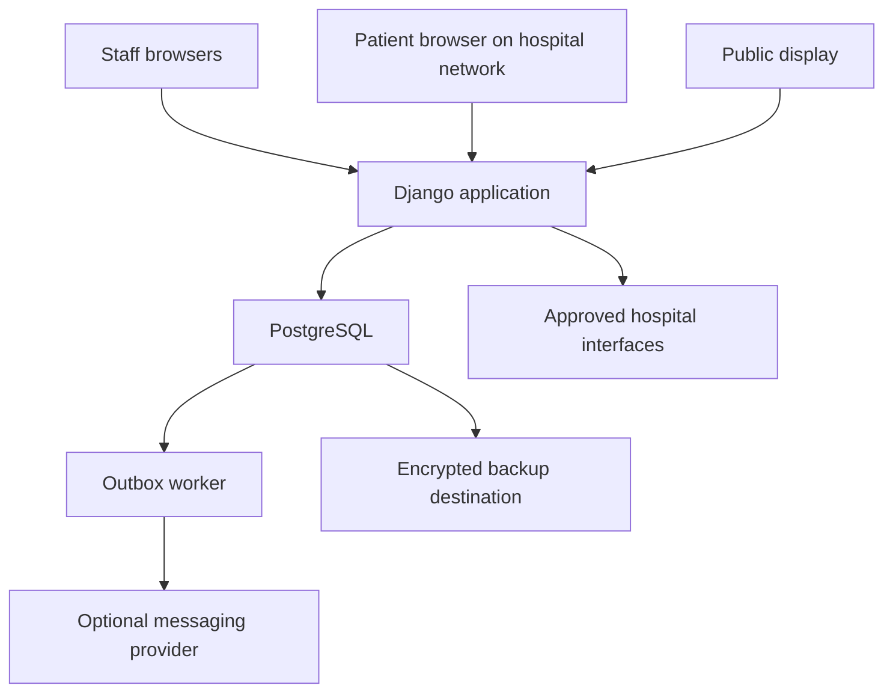

# Nepal Patient-Flow and Queue-Coordination Platform

## Planning blueprint • 27 October 2026 • Version 1.0

**Recommendation:** Build an assisted, browser-based coordination system for one hospital journey: registration → outpatient consultation → billing confirmation → one laboratory → doctor review. Give patients one visit reference, a clear next destination, and a place to wait without standing in successive lines. Keep clinical decisions and authoritative records with the hospital.

**Evidence labels used throughout:** Observed = to be established through hospital fieldwork; Verified source = supported by the source list; Assumption = a planning input that needs validation; Decision = a recommended design; Estimate = a budget, effort, or performance hypothesis, not a quotation or proven outcome.

No hospital partnership, local waiting-time statistic, payment integration, or regulatory approval is assumed. Sources were checked on 27 October 2026. This document describes a proposed system, not a deployed product.

## 1. A — Executive summary and project identity

### Proposed identity

| Possible name | Intended meaning |
|---|---|
| SewaPath | A path through services; confirm language and cultural fit with Nepali speakers |
| VisitLink Nepal | Links the stages of an individual visit |
| ClearStep Health | Makes the next action understandable |

These are working names; trademark and domain availability have not been checked. Use **SewaPath** provisionally.

**Mission:** Help patients complete hospital visits with less avoidable waiting, less confusion, and equal access to assistance, while helping staff coordinate safe and fair service.

**Working problem statement:** In some hospitals, registration, consultation, payment, investigations, review, and dispensing operate as separate workflows. Patients become the messengers between departments. This may cause repeated queues, duplicate entry, missed calls, unnecessary movement, and uncertainty. The size and causes of these problems must be measured at the pilot hospital.

**Guiding concept:** One visit ID, one coordinated patient journey, and a clear next step.

A patient identity identifies a person over time. A visit ID identifies a particular episode of attendance. One patient can have many visits. A short public token is merely an announcement label; it is neither identity proof nor authorization to view records. Returning another day can create a linked follow-up visit according to hospital policy, retaining the original order references. Citizenship or national ID is not required by the proposed system.

Primary beneficiaries are patients and caregivers, especially people who cannot stand for long, have limited literacy, travel far, or do not have phones. Institutional users include reception, clinicians, laboratory staff, cashiers, administrators, and IT personnel.

A token machine normally orders one queue. This product also tracks prerequisites, transfers, report readiness, department availability, and the patient's next destination across several queues.

**Smallest useful version:** Reception creates a visit; an OPD assistant calls and completes service; the patient receives a printed token and directions; staff can see current state and missed calls. Prove this before adding the laboratory loop.

**Non-goals:** Diagnosis, automated clinical triage, prescribing, interpreting results, replacing the hospital information system, maintaining a complete electronic medical record, automated insurance decisions, biometrics, and guaranteed waiting-time elimination.

Separate delays before trying to improve them:

| Cause | Example | Appropriate response |
|---|---|---|
| Necessary clinical or processing time | Consultation, laboratory processing | Explain timing; coordinate other eligible activities |
| Capacity shortage | More arrivals than available clinicians can serve | Measure demand; hospital changes staffing, slots, or referral arrangements |
| Administrative waiting | Re-entering demographics at every counter | Reuse authorized identifiers and visit context |
| Information transfer failure | Doctor does not know a report is available | Verified status and report reference |
| Uncoordinated queues | Two departments summon one patient | One active physical-service reservation |
| Navigation failure | Patient waits outside the wrong room | Consistent printed, screen, and staff directions |

## 2. B — Field research and problem validation

### Discovery plan

Request written authorization from hospital management and nominate a clinical workflow owner. Agree areas, hours, observer conduct, and whether the work is service improvement or research requiring ethics review. Do not independently decide that ethics review is unnecessary.

**Planning sample:** Observe 3–5 sessions across busy and quieter days; follow approximately 30–50 consenting patient journeys; interview 2–3 people from each available staff role and 10–15 patients/caregivers. These numbers support discovery, not representative national conclusions. Include people without phones and those who need assistance. Stop interviewing if care is needed.

| Interview group | Specific questions |
|---|---|
| Patients | Where were you unsure what to do? Which line did you join twice? How did you know your turn? What happens if you leave the waiting area? |
| Caregivers | Which tasks do you handle? Can you receive updates with permission? What would help without revealing private information? |
| Receptionists | How do you find existing patients? What causes duplicates? How are appointments, walk-ins, and missing documents handled? |
| Doctors | How are orders communicated? Which results must be ready before review? Who covers your return queue if you leave? |
| Nurses/triage staff | How are urgent cases identified and redirected? Who can change priority? What should never wait for a payment check? |
| Laboratory staff | What makes an order ready for collection? Who releases results? How do you handle rejected specimens or repeat collection? |
| Radiology staff | Which preparations, appointments, and safety checks affect readiness? What happens when equipment is unavailable? |
| Cashiers | What is the authoritative receipt? How are exemptions, refunds, duplicates, and delayed digital confirmations handled? |
| Pharmacists | What makes a prescription ready to dispense? How are unavailable medicines and partial dispensing communicated? |
| IT staff | Which systems and supported interfaces exist? Who controls networks, certificates, backups, and outages? |
| Administrators | Who owns the workflow? What counts as success? Who can authorize changes and fund ongoing support? |

### Observation template

Use anonymous study codes, not names or phone numbers:

| Study code | Visit type | Step/location | Arrival | Eligible/ready | Called | Service start | Service end | Departure | Delay reason | Physical line? | Assistance/rework |
|---|---|---|---|---|---|---|---|---|---|---|---|
| OBS-001 | OPD + lab | Sample collection | — | — | — | — | — | — | Payment confirmation | Yes/no | One repeated enquiry |

Record queue lengths at fixed intervals, such as every 10 minutes. Synchronize observer clocks. Measure waiting before eligibility separately from eligible queue waiting; measure service time as service end minus start. Record travel, administrative rework, and processing delays. Parallel intervals overlap, so do not add them blindly to obtain total visit duration.

Maintain an evidence register: claim, observation/interview source, date, sample size, conflicting evidence, confidence, and design implication. For example, “patients collect reports only to carry them to OPD” remains an assumption until staff confirm both present practice and a safe alternative.

Collect no diagnoses, report photographs, or unnecessary identifiers. Keep observation sheets access-controlled; agree a short retention period. Use separate hospital authorization for any live system data.

**Pilot selection:** Choose a hospital with a named sponsor, participating OPD/lab/cashier leads, existing devices, workable networking, a stable paper fallback, and permission to observe. Avoid starting in emergency, ICU, or a site demanding immediate hospital-wide integration. Before coding, know the authoritative records, each handoff owner, readiness rules, priority policy, return-review arrangements, and what happens during closure.

## 3. C — Current and proposed patient journeys

The current column is a hypothesis for validation, not a description of every Nepal hospital.

| Step | Current difficulty | Proposed improvement | Responsible owner | Information needed | Dependency/limitation | Benefit to validate |
|---|---|---|---|---|---|---|
| Registration | Repeated details and uncertain queue | Find/create patient once; issue visit and route | Reception | Existing hospital ID, minimal demographics | Human verification of uncertain matches | Less duplicate entry |
| Consultation wait | Standing and missed announcements | Seated waiting, token display, assisted call | OPD assistant | Check-in, clinician availability, staff priority | Does not increase doctor capacity | Less standing and fewer missed calls |
| Consultation/orders | Patient carries unclear instructions | Authorized staff records order references and next steps | Clinician or delegated assistant | Order ID, destination, prerequisites | Source order must remain authoritative | Fewer wrong destinations |
| Billing | Repeated payment enquiries | Cashier confirms invoice status or exemption | Cashier | Invoice reference, verified receipt | Payment interface may be unavailable | Less reconciliation rework |
| Sample collection | Wrong preparation or premature arrival | Join only when appropriate prerequisites are verified | Laboratory | Order, preparation confirmation, policy clearance | Staff controls suitability | Fewer rejected visits |
| Other investigations | Competing queues | Coordinate one physical task at a time | Destination department | Readiness and service window | Preparation may dictate sequence | Less backtracking |
| Processing | Waiting at counter for news | Show processing state and realistic return instruction | Lab/radiology | Verified stage and timestamp | Processing cannot be accelerated by software | Fewer enquiries |
| Reports | Queue just to carry paper elsewhere | Authorized staff uses existing report access/reference | Releasing department | Released report version and identity | Existing access must actually work | Avoid report-pickup trip where permitted |
| Doctor review | Treated as a new unexplained arrival | Dedicated, policy-approved review queue | OPD | Required results ready, patient present | Clinician availability and review policy | Clearer return access |
| Pharmacy | Unclear dispensing status | Later phase: readiness and collection instruction | Pharmacy | Prescription reference, stock/dispensing status | Existing pharmacy workflow | Less unnecessary standing |

### Required scenarios

1. **Walk-in OPD:** Reception registers or finds the person, checks them into an available session, and prints a token with room directions. A staff member calls the patient; consultation completion closes the visit or adds follow-up tasks.
2. **Consultation → laboratory → review:** Staff records the clinician's orders. Payment clearance/exemption is confirmed where applicable. Laboratory staff checks preparation, collects the specimen, and marks stages. Released results make review eligible, but only a present patient enters the review queue.
3. **Multiple investigations:** Create separate tasks with prerequisites. Specimen processing can continue while the patient attends imaging. Patient-attendance tasks cannot be called simultaneously. A clinician decides whether review requires all results or selected results.
4. **No smartphone:** Registration, printed directions, public token display, audio calls, and a help desk provide the same queue access. No OTP or installation is required.
5. **Older adult with caregiver:** Ask what assistance is wanted; record scoped caregiver permission where appropriate. The patient retains their own place. Staff assists with navigation and accessibility arrangements; age does not automatically become a clinical priority without approved policy.
6. **Results on another day:** Give a realistic return plan before departure. Keep the original orders linked; create a follow-up attendance when they return. Do not leave them occupying an active queue overnight. Optional messages say only that an update is available.
7. **Missed token/late arrival:** Attempt an assisted recall; mark temporarily absent after the approved interval. On return, confirm presence and apply a published re-entry rule. A suggested routine rule is the next appropriate slot after the currently called patient, preserving original waiting history and flagging repeated absence for staff review.
8. **Doctor unavailable/department closed:** Stop new calls, show the closure and help contact, and let staff offer an authorized substitute or rebooking. Preserve the visit and explain any fee/refund process; never silently transfer clinical responsibility.
9. **Urgent patient:** Staff immediately initiates the hospital's clinical assessment pathway. Queue processing, registration completeness, or payment must not delay that response. Document the routing afterward when safe.

**What changes:** Repeated administrative registration and report collection solely for internal transport may disappear if the hospital approves. Consultation, cash-payment, collection, imaging, review, and dispensing queues may become seated/virtual queues. Clinical assessment, identity verification, sample collection, examination, cash handling, and processing still take time. Software cannot promise all visits will become shorter.

## 4. D — Users, roles, and permissions

Authorization combines role, hospital, department, assigned work, and patient relationship. Hiding a button is insufficient: check permissions on every server request.

| Role | Permitted scope | Explicit boundary |
|---|---|---|
| Patient | Own next step, appointment and released status; later approved report access | No other patients or staff-only clinical information |
| Authorized caregiver | Specifically granted visit tasks and expiry | Relationship alone is not blanket permission; revocation ends access |
| Receptionist | Identity/visit administration, check-in, directions, routine re-entry | No general report browsing or clinical-priority changes |
| Doctor | Assigned patients' relevant orders/results; review decisions | No unrelated bulk record access |
| Nurse/triage staff | Approved clinical assessment workflow and priority assignment | Changes require identity, reason, timestamp, and policy scope |
| Laboratory staff | Relevant orders, specimen status, own department queue | Report release limited to designated personnel; no unrelated records |
| Radiology staff | Relevant orders, preparation and examination status | Clinical report release follows department authority |
| Cashier | Invoice/receipt references, payment verification; authorized refund workflow | No diagnostic results; refund approval may require a supervisor |
| Pharmacist | Relevant prescription, dispensing readiness and completion | No unnecessary clinical history |
| Hospital administrator | Capacity, staffing configuration, aggregate metrics | Administrative title does not confer universal medical access |
| System support | Health checks, redacted logs, deployment and account support | No routine clinical-content access; exceptional access is approved, time-limited and audited |

Department staff update only their own task states. Qualified staff control clinical priority. Operational supervisors can reroute or correct workflow within their authority with a recorded reason; they cannot invent clinical clearance. Designated privacy/security auditors inspect audit logs, with log access itself recorded. The pilot tracks refund references; the billing system performs the actual refund.

## 5. E — Product surfaces and screen specifications

A progressive web application (PWA) is a web application that can offer installation and selected caching features. Installation is optional. Neither a PWA label nor a service worker makes live queues safely available offline.

| Surface and timing | Pages/screens | Main actions and information | Loading, empty, error and offline states | Accessibility |
|---|---|---|---|---|
| Public website: pilot, minimal | Home, how it works, accessibility/help, privacy/contact | Explain participating services and assisted access | Static fallback; clear contact if page fails; no medical data | Nepali/English, keyboard, semantic headings |
| Patient responsive web/PWA: pilot on hospital network | Visit access, my next step, journey, help | Show destination, readiness, prerequisites and help | Loading label; no active visit explanation; retry/help on error; stale timestamp and no live promise offline | Large text/buttons, language toggle, text plus icons |
| Android/iOS app: defer | Same patient screens, later approved notifications | Optional convenience, no better queue position | Explicit synchronization and notification failure states | Screen reader, scalable text, accessible controls |
| Staff dashboard: pilot | Login, registration, department board, visit, exceptions | Search/register, call, start, complete, hold, redirect | No patients versus closed department are distinct; writes fail visibly; offline controls disabled | Keyboard workflow, focus indicators, no color-only states |
| Administration dashboard: pilot, small | Hours/counters, user roles, metrics, audit view | Configure service and inspect operations | No-data definitions; permission errors; read-only stale view | Accessible tables and downloadable summaries |
| Public display: pilot | Current calls, counter/room, help | Auto-refresh safe public tokens | Hide outdated calls and show “Please ask staff” after freshness timeout | Large type, contrast, visual plus discreet audio |
| Assisted station: pilot; self-service kiosk later | Staff registration now; limited check-in later | Human-assisted identity check; print token | Printer error offers handwritten token; kiosk timeout clears screen | Reachable seated height, staff assistance, no mandatory phone |

**Sitemap:** `/` → `/how-it-works`, `/help`, `/privacy`; `/visit/access` → `/visit/current`, `/visit/journey`, `/visit/help`; `/staff` → `/registration`, `/department`, `/visit/{id}`, `/exceptions`; `/admin` → `/hours`, `/users`, `/metrics`, `/audit`; `/display/{zone}`. These are route concepts, not deployed URLs. Internal IDs alone never grant access.

### Important screens

**My next step:** Put “Go to sample collection, Room 4” first, then “Ready” or “Please complete [verified prerequisite]”. Show floor/landmark, safe token, freshness time, and help location. Present only one recommended physical destination. Put optional later tasks underneath. Never show a rigid queue position when priority changes can invalidate it. Add “I need help”; do not treat that button as an emergency assessment service.

**Registration:** Search existing hospital ID first; use permitted demographic fields if absent. Show possible duplicates for human review. Capture name and the minimum hospital-required matching details, optional phone, language, and assistance needs. Distinguish approximate age from known date of birth. Confirm a short summary before creating a visit. Reprinting must reuse the existing token.

**Department board:** Separate waiting, called, in-service, absent, and blocked tasks. Show why each blocked task is blocked. Main buttons are “Call next”, “Start”, “Complete”, “Not present”, and “Get supervisor help”. Display counter status and data freshness. Verify identity at service start using hospital procedure; a token alone is insufficient.

**Visit detail:** Timeline of states, current location/reservation, assigned department, order references, prerequisite status, and action history. Clinical content appears only through separately authorized existing systems. Every correction requires reason and preserves prior history.

**Exception screen:** Group stale tasks, unavailable clinicians, unconfirmed payment, unmatched reports, long waits, and failed communications. Assign an owner and due time. Clearing an alert requires an explicit resolution, not merely hiding it.

**Design targets:** Nepali and English text reviewed by native speakers; Devanagari-compatible fonts; around 18px patient body text and 44px or larger main controls; responsive layouts; keyboard and screen-reader testing; WCAG 2.2 AA as a design target requiring actual verification. Never encode meaning by color alone. Validate with low-literacy users and real viewing distances. Translate hospital directions consistently across signs, printouts, and screens.

## 6. F — Core modules and priority

For every module below, inputs become validated state changes and audit events. “Owner” means the operational role accountable for accuracy.

| Module/phase | Purpose and inputs | Outputs | Dependencies/owner | Acceptance criterion |
|---|---|---|---|---|
| Registration — essential | Match minimal identity and create visit | Visit ID, public token, route | Reception; hospital identity procedure | Retry creates one visit; reprint preserves token |
| Walk-ins/check-in — essential | Admit present patients to an open session | Eligible consultation task | OPD hours/capacity; receptionist | No call before presence and eligibility |
| Appointments — basic pilot, self-booking later | Import/manual entry of approved slots | Scheduled task and check-in state | OPD schedule owner | Early/late arrival follows recorded policy |
| Visit/task tracking — essential | Coordinate state and dependencies | Next step, blocked reason, audit history | Department owners | Cannot complete invalid transition |
| Department queues — essential | Fair calling with available counters | One reserved call per patient | Staff priority and presence | Concurrent calls cannot claim same person |
| Order references — essential for lab loop | Record authorized clinician instruction/reference | Lab task and prerequisites | Clinician/assistant, source order | No task silently substitutes for clinical order |
| Billing status — essential for lab loop | Verify receipt, pending state or exemption | Confirmed workflow clearance | Cashier, billing authority | Screenshots/patient assertion cannot mark paid |
| Laboratory stages — essential | Record collection, processing, release status | Readiness and next step | Lab staff, existing results process | Processing is never displayed as released |
| Report reference — essential | Attach validated reference/version | Authorized review readiness | Releasing staff/source system | Correct patient/order link verified |
| Doctor review — essential | Required results + presence + clinician | Review task and completion | Clinician-approved readiness rule | Next-day result never auto-calls absent patient |
| Notifications — display essential; SMS next | Publish committed workflow events | Safe display/audio; optional message | Durable event log; staff fallback | Failed message never removes queue position |
| Operational analytics — essential | Aggregate timestamped transitions | Median/p90 waits and exceptions | Quality lead | Missing timestamps shown, not silently zeroed |
| Radiology — next | Preparation, scheduling and examination stages | Coordinated imaging task | Radiology protocol and staff | Prevents incompatible simultaneous call |
| Pharmacy — next | Valid prescription reference/readiness | Collection/partial fulfilment status | Pharmacist/source system | “Ready” requires pharmacy confirmation |
| Integrations — next | Supported vendor interfaces | Less manual status entry | Contracts, IT and vendor | Duplicate/out-of-order events handled safely |
| Multi-hospital/native apps — long term | Replicate validated workflows | Isolated institutions, optional convenience | Support capacity and proven demand | Tenant isolation and equivalent assisted access |

The pilot stores operational status, identifiers and references. It does not store report PDFs, diagnoses or full prescriptions. If existing staff cannot access reports internally, report collection will remain until an approved transfer mechanism exists; merely marking “ready” does not solve access.

## 7. G — Queue and journey coordination logic

### State model

Use states per service task, not one status to represent every activity in a visit.

| State | Meaning and allowed progress |
|---|---|
| Registered | Task exists; check prerequisites |
| Awaiting prerequisite | Preparation, order, policy clearance or required result missing; move to ready only after verification |
| Ready for service | Prerequisites satisfied; await check-in/admission |
| Waiting | Patient present and task admitted to an open queue |
| Called | Counter and patient reservation committed; awaiting arrival |
| In service | Staff verified arrival and began service |
| Temporarily absent | Recall unsuccessful; re-enter using policy |
| Completed | Service finished; may unlock dependent tasks |
| Cancelled | Task cancelled by authorized staff; reason required |

Laboratory processing is a separate non-attendance task. Collecting a specimen releases the physical patient reservation while processing continues. Uncertain prerequisites use an explicit unknown status; unknown is not equivalent to cleared.

### Scheduling rules

Use staff-assigned clinical priority first. Emergencies follow the hospital's separate immediate response pathway. Within the same approved clinical tier, use a documented appointment/walk-in/review allocation, then longest eligible wait. A possible starting routine cycle is appointment, walk-in, review, walk-in, skipping empty categories; the hospital must approve or replace it. Do not let remote bookings displace all walk-ins.

Record first eligibility, actual check-in and accumulated waiting separately. Early arrival should not acquire an appointment's scheduled priority hours early. Alert staff when waiting exceeds an agreed threshold; within a clinical tier, an aging rule can override the normal category cycle. Aging never automatically outranks urgent clinical need. Continued capacity shortage requires a supervisor response; no scheduler can guarantee bounded waits under overload.

Only open, staffed counters call patients. A visit/person can hold one active physical-service reservation across all departments. Use a hospital-patient-level reservation where identity is known, with visit fallback for provisional identities; flags and human checks address unresolved duplicates. Call reservations do not silently expire into another call while the patient may be receiving care. Staff must resolve ambiguous expired calls.

### Selection pseudocode

```text
call_next(counter, request_id):
    begin transaction
    lock counter's department scheduler row
    if request_id was already processed: return stored response
    verify staff permission, open hours, counter free, data freshness
    candidates = present, waiting tasks with satisfied prerequisites
                 compatible with this counter and service window
    order by approved clinical tier,
             within-tier overdue rule,
             approved category allocation,
             eligible waiting time and stable tie-breaker
    for task in candidates:
        try lock patient reservation row, then task row
        if lock unavailable: continue
        recheck current state, prerequisites and patient availability
        if patient already reserved elsewhere: continue
        reserve patient and counter; set task = CALLED
        update category allocation only for a successful call
        append audit event and notification-outbox event
        store request_id and response
        commit; return call
    store request_id and 'no eligible patient' response
    commit; return none
```

An outbox is a database table of messages/events written in the same transaction as the state change. A worker delivers them after commit, preventing an announcement for a call that failed to save. Display consumers recheck current task state before announcing delayed events.

```text
on_verified_task_change(task, expected_version):
    lock relevant patient/visit and tasks in consistent order
    reject stale version or unauthorized state transition
    update task; record source, actor, time and reason
    for dependent task:
        evaluate explicit prerequisite rules
        if prerequisites satisfied: mark ready
        admit to waiting only when patient is present and queue is open
    allow background processing without holding patient reservation
    choose next physical destination using required sequence,
        service windows and staff-approved routing preference
    if no safe route: assign staff-help exception
    commit audit/outbox with state changes
```

### Worked example

At 10:00, one OPD counter becomes free. All names below are fictional; displays would show tokens only.

| Person/token | Situation | Outcome |
|---|---|---|
| Asha / A12 | Routine walk-in, waiting since 09:35 | Remains eligible and ahead of later routine walk-ins |
| Bikash / A13 | Staff assigns higher clinical priority at 09:58; appropriate for this OPD pathway | Selected first because clinical priority precedes routine category allocation |
| Chandra / A14 | Checked-in 10:00 appointment | Selected at next routine appointment allocation if still appropriate |
| Dipa / A15 | Results ready; currently receiving imaging | Excluded until physical reservation is released and presence confirmed |
| Eshan / A16 | Called but absent; returns at 10:05 | Staff re-enters according to the disclosed missed-call policy |

After Bikash, the routine allocation selects Chandra if appointment is next; then Asha at the walk-in allocation. If Asha crosses the approved within-tier aging threshold, staff-approved aging can move her ahead. Dipa's background laboratory result never causes a competing physical call. A newly emergent patient is handled by staff immediately, outside this routine example.

Payment clearance is a prerequisite only for services where hospital policy and applicable obligations permit it. Model paid, pending, unknown, exempt, waived and disputed separately. Urgent clinical routing must not depend on payment.

### Wait estimates

Start with no numeric promise. After collecting reliable data, simulate the current queue using service-duration distributions for comparable service types, working counters, tasks already in service and the approved allocation rules. Show a calibrated range, such as the 20th–80th percentile of predicted time-to-call, clearly labelled an estimate; validate how often actual waits fall within it. A crude workload-per-counter calculation can inform staff but should not masquerade as a precise patient forecast.

Suppress estimates when samples are small, timestamps stale, counters unavailable, queues paused, or urgent arrivals make the model unreliable. Distinguish “time until collection” from “time until report release”. Failed SMS, closed browsers or unread notifications never mean the patient forfeits service.

## 8. H — Technology stack and programming languages

### Compare three feasible approaches

| Stack | Strength | Main burden | Recommendation |
|---|---|---|---|
| Python + Django + server-rendered HTML/CSS + small JavaScript + PostgreSQL | One application, straightforward forms, authentication and workflow logic | Learn Python, relational data and safe deployment | Default for a small student team |
| TypeScript + React/Next.js + Node.js backend + PostgreSQL | Strong choice if team already knows JavaScript and needs richer interactions | More client/server state and build complexity | Choose if existing team skills outweigh the extra complexity |
| Python Django API + Flutter/Dart + web staff dashboard + PostgreSQL | Shared mobile UI approach for a later native product | Additional language, API and mobile release lifecycle | Defer until native functionality is demonstrably necessary |

FastAPI is a reasonable Python alternative for an API-led product, but assembling administration, permissions and workflow screens is additional work. No framework resolves clinical workflow or concurrency by itself. This comparison is a design judgment, not a performance benchmark.

### Selected stack

| Technology/category | Role and fit | Learning/cost/maintenance | Switching trigger |
|---|---|---|---|
| Python — language | Business rules and worker | Moderate learning; one backend language | Keep unless team capability strongly favors TypeScript |
| HTML/CSS + JavaScript — web languages | Accessible responsive pages and periodic updates | Low-to-moderate complexity; minimal dependencies | Add TypeScript/React only when interactions justify it |
| Django — framework | Modular application, templates, authentication | Moderate learning; use supported releases and patch regularly | Extract APIs as other clients appear |
| PostgreSQL + SQL — database/query language | Durable states, constraints and transactions | Moderate SQL learning; backups and monitoring essential | Scale hardware/query design before changing database |
| HTTPS with periodic polling — transport | Refresh staff/display state every 3–5 seconds initially | Simple; measure load and freshness | Server-sent events/WebSockets only if measured need warrants |
| Database outbox + Python worker — jobs | Notifications and integration retries | No separate broker initially; supervision required | Dedicated queue when throughput or scheduling complexity warrants |
| Django sessions + role/object permissions | Staff and scoped patient access | Secure cookies, CSRF controls, audit; staff MFA where practical | Hospital SSO if available and approved |
| Linux host + production application server + reverse proxy | One locally administered deployment | Requires an identified operator; recurring patching | Approved cloud deployment if support/network conditions favor it |
| Git, automated tests, redacted logs, backup tooling | Change control and recovery | Set up early; recurring restore exercises | Add managed monitoring as support grows |

Django's official deployment checklist requires deliberate production configuration and warns against using its development server for production. Follow that checklist, including production checks, secrets, HTTPS and secure settings [S1]. PostgreSQL documents row locking and SKIP LOCKED for queue-like access; skipped rows are not a consistent general-purpose data view [S2]. Test locking on PostgreSQL itself, not only a substitute development database.

The first deployment uses ordinary browser pages; optional installation and static-asset caching can follow. Browser-specific installation/push behavior, payment APIs, SMS contracts and hospital interfaces have not been verified for the target environment. Do not make them pilot dependencies. No microservices, AI, blockchain or Kubernetes are needed.

## 9. I — Architecture, data model and APIs

### Architecture



Default: one hospital-managed host on the local network, with HTTPS and restricted access. The optional public information site is separate and contains no patient data. Remote patient status requires a separately secured, hospital-approved external access design; do not expose a local database or open arbitrary router ports. The first local pilot offers patient web access on an isolated guest network with narrowly allowed HTTPS access, or assisted access if that cannot be configured safely.

**Codebase structure:** `config/`, `apps/identity/`, `apps/visits/`, `apps/queues/`, `apps/orders/`, `apps/billing_refs/`, `apps/notifications/`, `apps/audit/`, `templates/`, `static/`, `locale/`, `tests/`, `ops/`, `docs/`. Keep one deployable application with explicit module boundaries.

| Entity | Key relationships and fields |
|---|---|
| Hospital, department, counter | Hospital owns departments; counters have hours, service types and availability |
| Patient | Internal ID, external hospital ID, minimal matching data; one-to-many visits |
| Caregiver authorization | Patient, caregiver identity, permitted actions, expiry, verification, revocation |
| Staff assignment | User, hospital, department, role and approved scope |
| Visit | Patient, attendance date, parent/follow-up link, safe display token, presence |
| Appointment | Department/clinician, slot, visit link, check-in and cancellation |
| Service task/queue entry | Visit, service, state, priority source, readiness, wait timestamps, version |
| Task dependency | Predecessor and successor plus explicit completion/readiness rule |
| Patient reservation | Patient or provisional visit, task, counter, reservation state |
| Order reference | Source ID, ordering authority, service, prerequisite confirmation |
| Invoice/payment reference | Source invoice, verified status, amount if necessary, source timestamp, cashier |
| Specimen status | Source accession reference and collection/processing/rejection state |
| Report reference | Source report ID, release/version status; no clinical content in pilot |
| Prescription reference | Later-phase source prescription and dispensing state |
| Notification/outbox | Event ID, safe payload, channel, attempts, result and retry time |
| Audit event | Actor, action, entity, previous/new operational state, reason, time |

**Authority:** Hospital registration owns established identity; the pilot owns its visit/task state; clinicians own orders; billing owns financial records; lab/radiology systems or authorized staff own report release; pharmacy owns dispensing. Manual updates record source and actor. “Last update wins” must not overwrite these authority boundaries.

**Duplicates:** Suggest matches but never auto-merge by name or phone. Shared phones are common possibilities. Authorized identity staff compare approved identifiers, link aliases, review affected orders and preserve a reversible audit trail. Do not merge financial or medical references without confirmation.

**Concurrency:** Lock and recheck before calling; enforce database uniqueness for active patient reservations and counter occupancy. Use consistent lock order, short transactions and bounded deadlock retries. Update with expected version numbers; return a conflict for stale edits. Every retryable mutation takes an idempotency key: the same key and payload yields the same result; different payload with the same key is rejected.

**Representative APIs:**

| Method/path | Purpose and guard |
|---|---|
| POST `/api/visits` | Reception creates a visit; duplicate submission protected |
| POST `/api/visits/{id}/check-in` | Confirm presence within authorized scope |
| GET `/api/visits/{id}/journey` | Authorized next-step/status view |
| POST `/api/counters/{id}/call-next` | Transactional selection; no client-chosen priority |
| POST `/api/tasks/{id}/start` | Identity/presence check and expected version |
| POST `/api/tasks/{id}/complete` | Authorized state transition |
| POST `/api/tasks/{id}/absence` | Reasoned absence; no implicit completion |
| POST `/api/tasks/{id}/priority` | Qualified staff only; reason required |
| POST `/api/orders/{id}/status-events` | Validated source event; deduplicate external ID |
| POST `/api/invoices/{id}/verification` | Cashier or approved verified integration |
| GET `/api/display/{zone}` | Only safe public tokens, destination and freshness |
| GET `/api/metrics` | Authorized aggregates, no raw identifiers |

Example event flow: receptionist checks in visit → OPD call committed → display receives event → consultation completes → authorized lab reference created → cashier verifies clearance → lab confirms preparation → specimen collected → patient reservation released → result released in source system → staff verifies reference → present patient becomes eligible for review → doctor completes review.

Use UTC timestamps in storage and `Asia/Kathmandu` for local display/session boundaries. Record event occurrence and receipt times separately. Label Gregorian versus Bikram Sambat dates explicitly; do not write ad hoc conversion logic. Synchronize host clocks.

Use exponential backoff with jitter for external retries, a maximum attempt threshold, and a staff exception queue. Detect out-of-order source events; a delayed “processing” message cannot revert a released report without an authorized correction.

FHIR means Fast Healthcare Interoperability Resources, an HL7 standard for exchanging healthcare data [S3]. If the vendor supports it, map existing identifiers and relevant resources such as Encounter, ServiceRequest and DiagnosticReport using the vendor's supported version. FHIR is not automatic interoperability. Obtain interface documentation, permissions and test access; do not read hospital databases directly without authorization.

For later multi-hospital support, prefer separate database/deployment boundaries initially. A shared deployment needs tenant keys in queries/constraints, scoped staff roles, tenant-specific backups/exports and explicit isolation tests. Never assume names are globally unique.

## 10. J — Hardware and physical deployment

**All ranges are unverified NPR planning allowances dated 27 October 2026 unless a listing is identified.** Quantities describe a small pilot with four functional staff stations: reception, OPD, cashier and laboratory. Existing equipment should be reused. Check warranties, taxes, installation and supply availability before buying.

| Item | Purpose/placement | Minimum practical planning specification | Status/quantity | Unit allowance NPR | Maintenance concern |
|---|---|---|---|---|---|
| Existing desktop/laptop | Four staff stations | Supported OS/browser, about 8 GB RAM, reliable network | Essential: 4 available; buy only gaps | Reuse: 0; replacement 25,000–60,000 | Updates, damaged peripherals, shared accounts prohibited |
| Reception tablet | Alternative assisted station | About 10-inch display, supported browser, stable stand | Optional: 0–1 | 20,000–40,000 | Charging, theft, breakage, browser support |
| Thermal printer | Printed visit/directions at reception | 80mm, tested driver and Nepali raster output | Recommended: 1; paper substitute allowed | 9,000–18,000 | Rolls, cutter/head, driver compatibility |
| QR/2D scanner | Faster reference entry | USB keyboard input; reads required codes | Optional: 0–2 | 3,000–10,000 | Cable and scan quality; manual entry fallback |
| Public display | Waiting area token calls | Reused TV/monitor, readable at actual distance | Recommended: 1 | Reuse: 0; new 20,000–40,000 | Burn-in, screen positioning, display player |
| Display player | Connect screen to web display | Reused small PC with supported browser | Needed if screen cannot run display: 0–1 | Reuse: 0; 10,000–25,000 | Auto-start, updates and watchdog |
| Speakers | Token and counter audio | Clear speech at appropriate volume | Optional: 1 set | 1,500–5,000 | Noise, audibility, visual alternative |
| Router/switch/cabling | Protected local network | Guest/staff separation, sufficient ports and coverage | Essential: 1 network set | 8,000–20,000 | Configuration backup, spare cables, access control |
| UPS | Host/network continuity and shutdown | Load-tested sizing; VA rating alone insufficient | Essential local-host plan: 1–2 | 10,000–25,000 | Battery replacement, runtime testing |
| Local host | Application/database | Reused reliable PC; roughly 4 cores, 8–16 GB RAM, SSD | Essential local plan: 1 | Reuse: 0; 35,000–70,000 | Disk/power failure; physical security; spare path |
| Backup drive | Encrypted rotating backup | Adequate capacity; at least two rotations preferred | Essential: 1–2 | 6,000–12,000 | Key custody, drive loss, restore testing |
| Kiosk enclosure | Later independent check-in | Accessible height and service access | Deferred: 0 | 60,000–150,000 | Custom parts, cleaning, repairs |

A Nepal retailer listed the ZKP8016 80mm printer at NPR 8,700 including tax when checked [S6]. This is a single price reference, not an endorsement or proof of Nepali-language driver compatibility. Other item ranges are estimates, not locally verified quotations.

Print a short token, date/session, destination and help instruction. A QR encodes an opaque reference, not name, diagnosis or medical data. A scan by authenticated staff retrieves the authorized record. Patient access can use a separate short-lived, high-entropy capability scoped to minimal journey status; it must not expose reports. Public short tokens never unlock a private page.

Announce “Token A12, Counter 2”, not names, test types or diagnoses. In sensitive service settings even department labels may reveal information; use neutral zones and review physical placement. People with hearing or vision impairments need staff assistance as well as display/audio alternatives.

Printer failure: use a pre-numbered downtime slip tied to the existing visit; never create a second visit to obtain a new print. Keep rolls, signage and pens on site. Confirm actual Devanagari output before purchase; bitmap printing is a possible implementation to test.

A Raspberry Pi may be useful as a display player when already available and locally supported. It is not a requirement and does not inherently provide server reliability. A refurbished business computer with SSD and replaceable parts may be easier to maintain. No biometric hardware is proposed.

## 11. K — Offline operation, reliability and recovery

**Decision:** Use one authoritative local server for the supervised pilot if the hospital can support it. Do not introduce two independently writable local/cloud systems.

| Failure | What remains available in local-host design | What pauses | Recovery |
|---|---|---|---|
| Internet fails, LAN works | Local registration, queues, displays and staff status | SMS, remote access and external integrations | Retry external events; reconcile receipts; mark unverified states unknown |
| LAN fails | Existing clinical care and paper workflow | Shared digital calls/updates | Coordinator declares paper mode; repair network; reconcile ledger |
| Power fails | Battery-backed equipment temporarily, paper thereafter | Unsupported devices; host after controlled shutdown | UPS protects shutdown; restart only after stable power |
| Backend/database fails | Clinical and manual service | Digital mutations and authoritative live status | Hide stale calls; restore/fix; verify before resuming |
| One device fails | Other authorized stations | Work on that device | Use spare device with individual login; reprint same token if needed |

Cached pages show a prominent stale/offline notice, never a live-looking queue. Do not queue staff state-changing actions in browser storage in the first version. A PWA cache does not replace a functioning server or network.

Cloud hosting reduces on-site server responsibility but makes connectivity a dependency for all online workflow. A future cloud option should budget redundant connectivity and retain paper fallback. Off-site encrypted backup is different from active bidirectional synchronization.

**Paper transition:** One named shift coordinator declares outage time and stops digital calling. Each department records calls, starts, completions and exceptions using existing visit references. For new visits, use unique downtime IDs containing date, department and a preallocated sequence. Reuse these as aliases during reconciliation; never renumber without retaining the mapping.

**Return to digital:** Freeze new digital calls, collect departmental ledgers, verify the patient currently in service at each counter, enter events with original and entry timestamps, resolve discrepancies with staff, and compare pending counts. A supervisor explicitly authorizes restart. Do not blindly replay stale events or auto-call everyone marked waiting before the outage.

**Pilot recovery targets, subject to drills:** paper fallback initiated within 5 minutes; standard host recovery within 2 hours; at most 15 minutes of database-event loss after catastrophic host failure if tested off-host log archiving is installed. If only nightly backups are implemented, disclose up to one day's digital loss and rely on paper reconciliation. Do not advertise the stronger target until tested.

Use encrypted daily backups plus suitably frequent off-host database log archiving for the stronger target. Test a restore before launch and monthly during operation, including recovery keys, event counts, identity links and outstanding queues. A second drive left in the same host does not cover theft or host-wide loss.

## 12. L — Privacy, security and clinical safety

Collect only information required for identity matching and workflow. Data that “might be useful later” is not sufficient reason to collect it. Use synthetic people, receipts and results in development, demonstrations and automated tests.

Use HTTPS, encrypted host storage/backups, restricted database access, separate service accounts and secure secret storage. Staff should have individual accounts; end sessions after appropriate inactivity; prevent browser caching of sensitive pages; use secure session cookies and CSRF protection. Rate-limit access attempts. Patient recovery must not depend exclusively on a phone or knowledge of a public token.

Log access and consequential changes without copying medical content into general application logs. Record reasoned overrides, export activity and exceptional support access. Protect audit storage from routine alteration and export it to a separately controlled destination where feasible. Audit trails support investigation; they are not automatically tamper-proof.

Caregiver permission must have scope, verification, duration and revocation. Procedures for minors, incapacity and emergency circumstances require hospital/legal review; do not invent a universal consent rule. Generic SMS should say only that an update is available and where to seek help. A shared phone must not expose sensitive service details.

Agree retention separately for patient/visit references, clinical records held elsewhere, operational events, access logs and backups. An illustrative analytics policy might aggregate and de-identify old workflow data, but exact periods require approval. Document deletion/export and backup-expiry behavior. Hospital data must not be sold or used for unrelated model training.

### Nepal legal verification

The Nepal Law Commission publishes the Privacy Act, 2075 [S4]. Government health sources publish the Public Health Service Act, 2075 (2018) [S5]. These establish authoritative starting points for the hospital's review. This blueprint does not establish the complete current amendment position or certify compliance; the full health-act PDF could not be retrieved reliably in this session.

Before real-patient use, ask hospital counsel/privacy leadership to verify: lawful collection and use; patient notice/consent requirements; confidentiality and authorized disclosures; caregiver/minor handling; emergency-care and payment obligations; hosting and cross-border transfer restrictions if any; retention and access/correction rights; breach reporting duties; research approvals; procurement and vendor contracts. Do not assume GDPR, HIPAA, or a foreign compliance badge establishes Nepal compliance.

**Incident response:** Staff reports suspected exposure or incorrect routing to named hospital and technical leads; isolate affected access, preserve evidence, maintain care through fallback, assess impact with qualified personnel, and make required notifications according to verified obligations. Fix and test before restoring access. Report availability is never clinical interpretation; a critical result follows the hospital's clinical escalation procedure and must not rely on this queue system's ordinary notifications.

## 13. M — Pilot plan and development roadmap

**Bounded scope:** One outpatient service, one cashier interface, one laboratory collection point, and a defined doctor-review session. Include non-emergency walk-ins, manual appointment entry, no-phone assistance, and documented staff-led redirection. Keep radiology, pharmacy integration, online payments, full report storage and public self-booking out of the first live phase.

**Planning load assumption:** Approximately 30–60 participating visits per day, capped to what staff can supervise. Confirm actual arrival rates and increase only after stable operation. The system does not change eligibility for care.

| Phase | Deliverables | Dependencies and responsible roles | Effort estimate | Completion criterion | Main risk |
|---|---|---|---|---|---|
| Discovery | Observations, baseline, evidence register | Permission; student + hospital sponsor | 20–40 hours plus access lead time | Workflow and bottlenecks reviewed by staff | Designing from assumptions |
| Workflow design | States, roles, exception rules, paper procedure | Clinical lead, cashier/lab leads | 20–35 hours | Each handoff has owner and fallback | Conflicting policies |
| Prototype | Synthetic clickable/browser flow, printed mock token | Student, representative staff/patients | 25–45 hours | Users can identify and perform next step | Attractive interface hides workflow gaps |
| Implementation | Registration, calls, dependencies, audit, reports | Developer, IT support | 80–140 hours | Complete synthetic lab loop works | Scope growth |
| Testing/hardening | Concurrency, permissions, recovery, accessibility evidence | Developer + independent reviewer + staff | 40–70 hours | No unresolved critical failures | Solo developer misses defects |
| Training/shadow mode | Role guides, drills, paper comparison | Department champions | 15–25 hours plus 3–5 observed sessions | Staff can handle absent patient and outage | Double entry burden |
| Supervised live pilot | Limited sessions, daily issue review | Signed hospital readiness decision; on-site owner | 2–4 weeks, budget 40–80 support hours | Safe operation and reliable records | No available support |
| Evaluation | Baseline comparison, interviews, cost/support findings | Quality lead and student | 15–25 hours | Hospital decides stop, revise or expand | Mistaking capacity changes for software effect |

Total development/planning effort before support is roughly 215–380 hours. At 12–15 hours weekly, allow approximately 4–8 months for a solo student, with hospital approval lead times possibly longer. A small team providing 30–40 combined hours weekly may reach supervised launch in roughly 8–14 weeks, then complete the live evaluation. These are planning ranges, not delivery commitments.

Synthetic demo: create 12 fictional patients including duplicate names, a no-phone patient, caregiver, late arrival, pending payment, waived fee, rejected specimen, delayed report, unavailable doctor and simultaneous counter calls. Demonstrate one complete visit and an outage/recovery. No real patient screenshots.

**Launch gate:** clinical owner approval, verified permissions, staff competency, functioning fallback, restoration drill, confirmed source-of-truth rules and a support roster. Students must not become the sole uncontactable production dependency.

**Rollback:** Immediately pause digital calling for unsafe duplicate calls, wrong-patient associations, privacy exposure, or unreconciled state. Department heads use paper and existing systems. Preserve evidence and reconcile affected visits. Restart only after the hospital owner verifies the correction; never make access to care depend on the experiment.

## 14. N — Testing and success measurement

| Test area | Required scenario and expected result |
|---|---|
| Functional | Full OPD/lab/review loop; invalid state changes rejected |
| Identity | Duplicate names, shared phone, uncertain age; no automatic merge or wrong report link |
| Permissions | Every role tries another department/patient endpoint; prohibited reads/writes fail server-side |
| Caregiver | Scoped grant, expiry and revocation; revoked session loses access |
| Concurrency | Two counters call same candidate simultaneously; exactly one reservation succeeds |
| Idempotency | Retry visit creation, payment status and call request; no duplicate effects |
| Results | Delayed, corrected, partial and rejected-specimen states; readiness follows approved dependencies |
| Billing | Delayed provider confirmation, duplicate receipt and disputed reference; unknown remains unknown |
| Appointments | Early arrival, late arrival, absence, re-entry, over-capacity and closing time |
| Accessibility | Keyboard/screen reader, enlarged text, low literacy, no phone, crowded display visibility |
| Language | Nepali glyphs in browser and print; translated errors and consistent destinations |
| Reliability | Disconnect WAN, LAN, single device and backend; stale display cannot keep calling |
| Recovery | Restore onto replacement host; reconcile paper and verify active patients before reopening |
| Overrides | Unauthorized priority changes blocked; authorized changes require reason and appear in audit |
| Load | Use observed peak load plus a stated margin; check response time, errors and database contention |

Run concurrency tests against the real database engine. Have someone other than the author challenge permission assumptions. Use end-to-end user scenarios rather than only testing individual functions.

| Metric | Definition and collection |
|---|---|
| Total visit duration | First arrival to final departure for same-day visits; report multi-day elapsed time separately |
| Waiting versus active service | Time-stamped observation/task events; separate travel and background processing; avoid overlap double-counting |
| Physical queues | Number of distinct occasions spent standing in line per observed visit |
| Missed calls | Called patients not arriving within policy interval / total calls, with reason where known |
| Incorrect routing | Patients sent to an inappropriate location or before prerequisites / observed visits |
| Staff workload | Minutes of administrative effort per visit plus exception work; measure system-induced work too |
| Satisfaction | Short accessible patient/staff survey; offer verbal response and report response rate |
| Availability | Successful critical workflow checks during scheduled pilot hours, including network outages; distinguish backend-only uptime |

Collect baseline and pilot sessions at comparable times and service mixes. Report sample sizes, missing data, median and 90th percentile, not just averages. Separate phone/no-phone and assistance groups where sample size and privacy permit. Track staffing, attendance and test mix changes as confounders; do not attribute every change to software.

**Initial hypotheses:** 20% reduction in avoidable administrative waiting; one fewer physical queue for the lab/review cohort; fewer routing errors; no deterioration in no-phone access. These are proposed tests, not expected guarantees. Safety targets are zero wrong-patient disclosure and zero duplicate active physical calls; any occurrence triggers review. If total time is unchanged but standing and confusion improve, document that benefit accurately.

## 15. O — Budget and social sustainability

All totals below are illustrative cash planning budgets in NPR as of 27 October 2026, not vendor quotations. They exclude student labor, hospital staff salaries, facility renovation, major power infrastructure, medical equipment, tax/shipping differences except where explicitly included in a source, and proprietary integration fees until quoted.

### Prototype

Existing laptop and synthetic data: NPR 0 hardware; optional domain/demo hosting 0–5,000; travel/interviews 3,000–10,000; printing/consumables 1,000–3,000; contingency 1,000–5,000. **Prototype cash allowance: 5,000–23,000.** No production patient data in informal demo hosting.

### Pilot setup examples

| Setup line | Reuse-heavy local pilot | More resilient local pilot |
|---|---:|---:|
| Four staff stations | 0, all reused | 60,000, two replacements assumed |
| Local host | 0, suitable dedicated existing host | 50,000 |
| Token printer | 12,000 | 15,000 |
| Display/player | 0, both reused | 35,000 |
| Network improvements | 10,000 | 18,000 |
| UPS provision | 12,000 | 30,000 |
| Backup media | 8,000 | 16,000 |
| Audio | 2,000 | 3,000 |
| Training, travel and signs | 8,000 | 15,000 |
| Local configuration/security assistance | 10,000 | 20,000 |
| Subtotal | 62,000 | 262,000 |
| Contingency, approximately 15% | 9,300 | 39,300 |
| **Setup allowance** | **71,300** | **301,300** |

These examples require the listed reused equipment to be reliable and available; otherwise add replacements from Section J. They do not include custom HIS integration. Reserve a provisional additional NPR 20,000–100,000+ only if integration is required, then replace that placeholder with a written scope and quote.

### Monthly operating allowances

| Cost | Reuse-heavy | More resilient |
|---|---:|---:|
| Approved backup/hosting services | 500–2,000 | 1,500–5,000 |
| Incremental connectivity | 0–1,500 | 1,000–3,000 |
| Optional messaging | 0–1,000 | 500–2,000 |
| Paper/consumables | 500–1,500 | 1,000–2,000 |
| Technical support allowance | 4,000–8,000 | 8,000–15,000 |
| Maintenance/replacement reserve | 1,000–2,000 | 2,000–4,000 |
| **Monthly total** | **6,000–16,000** | **14,000–31,000** |

Confirm electricity, tax, hosting location and SMS rates separately. Calculate messaging as actual messages × contracted price, including retries and fees. Price support from actual hours: these allowances do not buy 24/7 coverage. For a three-month pilot, setup plus operations is approximately NPR 89,300–119,300 for the reuse-heavy example or NPR 343,300–394,300 for the resilient example, excluding prototype and optional integration.

| Sustainability model | Benefit | Limitation |
|---|---|---|
| Hospital subscription/support contract | Recurring funding and accountable maintenance | Must demonstrate operational value and procurement fit |
| University or innovation grant | Funds validation without patient charges | Often temporary; transition plan needed |
| NGO partnership | Supports underserved hospitals and accessibility | Reporting/mission requirements and funding cycles |
| Institutional sponsorship | Can fund equipment and deployment | No access to patient data or paid queue advantage |
| Open-source software with paid support | Portability, learning and local maintenance options | Open source does not eliminate support costs |

Recommend a grant/university-backed pilot followed by a hospital support agreement if measured benefits justify it. Patients should not pay for queue position or need a phone for essential access. Do not sell patient information.

Before collaboration, document code ownership under student/team/university rules and choose a license consciously. The hospital should retain control of its data, export access, and recovery credentials. Provide documented CSV/JSON exports, data dictionary, source/deployment documentation, dependency licenses and migration support. Include an exit/deletion process and avoid proprietary identifiers that cannot be mapped back.

Before graduation, assign a maintainable support owner: hospital IT, a local company/cooperative, or an explicitly funded university program. Train at least two people. Do not promise indefinite volunteer availability; if maintenance cannot be funded, the hospital must be able to export data and safely retire the product.

## 16. P — Expansion beyond hospitals

Reusable components include check-in, appointments, counters, operational queues, prerequisites, public tokens, accessible notifications, audit trails, availability and aggregate waiting metrics.

Hospital-only logic includes clinical priority, orders, specimens, reports, caregiver/clinical access, emergency pathways and clinician review. Keep these in separate modules and policies. A bank might use identity-verification prerequisites; a government office might use document-completeness checks. Neither should inherit medical assumptions or hospital records. New institutions require fresh workflow research, privacy review and pilot validation. Expansion is outside the first hospital pilot.

## 17. Q — Final implementation brief

1. **First product:** An assisted browser application that coordinates a visit and makes the next step explicit, with printed tokens, safe public display and staff controls. Patient PWA access is optional; native apps wait.
2. **Exact pilot:** One hospital, one OPD service/session, reception, one cashier status workflow, one laboratory collection point and a defined doctor-review session. First prove registration/OPD alone; add the lab loop after that gate. No emergency-department scheduling, full medical-record replacement or live radiology/pharmacy integration.
3. **Languages/stack:** Python, HTML, CSS, JavaScript and SQL; Django, PostgreSQL, HTTPS browser polling and a database-outbox worker; one Linux deployment. Use maintained versions and official deployment guidance.
4. **Minimum hardware:** Four available staff stations, one reliable dedicated host, protected local network, appropriately sized UPS, encrypted off-host backup, paper materials and an assisted calling method. One reused display and printer are strongly recommended; no phone, biometric device or kiosk is required of patients.
5. **Assumptions to validate:** Named clinical/operational owner; staff can update status reliably; report access exists; a limited pilot is permitted; hospital network and fallback work; manual receipt verification is acceptable; no-phone access is practical; clinical priority and return-review rules are agreed.

### Five largest risks

| Risk | Mitigation |
|---|---|
| Staff must enter everything twice and abandon the tool | Observe workload, minimize fields, assign handoff owners, integrate only where supported |
| Wrong identity or stale state creates unsafe routing | Human matching, source references, freshness limits, transactional reservations and audited corrections |
| Unfair access for no-phone or vulnerable patients | Equal paper/assisted route, published rules and subgroup evaluation |
| Power/network/backend interruption stops coordination | Local authority, tested UPS/backups, simple paper fallback and supervised reconciliation |
| No maintenance after student graduation | Funded support agreement, documentation, two trained maintainers and tested export/exit |

### First-week checklist

- Write a one-page hospital introduction explaining the bounded problem and proposed observation work.
- Contact a plausible pilot hospital and seek an administrative sponsor plus clinical workflow owner.
- Obtain observation permission and clarify ethics/privacy review requirements before patient research.
- Prepare the anonymous journey sheet and role-specific interview questions.
- Inventory available devices, connectivity, power protection and existing hospital systems.
- Walk the OPD–cashier–lab–review route with staff and draw its actual handoffs.
- Identify three avoidable problems supported by evidence; record unknowns separately.
- Create a paper or synthetic-data mockup of registration, department calling and “My next step”.
- Review it with staff and at least one no-phone/assisted-use participant when permitted.
- Agree the smallest testable outcome before writing a large application.

### Essential questions for the student

1. Which languages and frameworks can you already build and debug with?
2. How many people can commit, how many hours per week, and for how many months?
3. What cash budget is available, and is there a university supervisor?
4. Do you have a hospital contact and permission to observe workflows?
5. Is the first deliverable an academic prototype, a funded pilot, or a commercial proposal?

### Essential questions for the hospital

1. Who owns clinical workflow, technical operation, privacy review and the launch decision?
2. What is the actual daily arrival pattern, current staffing and baseline patient journey?
3. Which source systems own identity, invoices, orders, released results and prescriptions?
4. Are supported integrations available, and who can authorize/test them?
5. What are the approved rules for priority, appointments, absence, fee exemptions and review visits?
6. What must happen when results are delayed or the doctor is unavailable?
7. Which equipment/network/backup facilities can be reused and who maintains them?
8. How will non-phone users, caregivers, people with disabilities and low-literacy patients receive equal assistance?
9. Which legal, ethics, hosting and retention decisions require sign-off?
10. Who funds and delivers ongoing support if the pilot succeeds?

## Source register and verification limits

Sources below support specific factual references, not the proposed architecture's safety or the estimated project outcomes. Product designs, budget totals and effort estimates are recommendations requiring validation.

- **[S1] Django official deployment checklist:** https://docs.djangoproject.com/en/5.2/howto/deployment/checklist/ — production deployment safeguards; reviewed 27 October 2026. Pin a maintained release at implementation time.
- **[S2] PostgreSQL official SELECT documentation:** https://www.postgresql.org/docs/current/sql-select.html — row locking and SKIP LOCKED behavior; reviewed 27 October 2026.
- **[S3] HL7 official FHIR overview:** https://www.hl7.org/fhir/overview.html — health-information exchange standard; reviewed 27 October 2026. Vendor support and version remain unverified.
- **[S4] Nepal Law Commission, Privacy Act 2075:** https://lawcommission.gov.np/content/12261/the-privacy-act-2075/ — official publication located; complete legal interpretation and current amendments require verification.
- **[S5] Government HMIS, Public Health Service Act 2075 (2018):** https://hmis.gov.np/posts/single/the-public-health-service-act-2075-2018 — official publication located; full linked PDF retrieval was unreliable in this session. No section-specific legal conclusion is made here.
- **[S6] Absolute Computer & Mobile, ZKP8016 listing:** https://absolutecomputer.com.np/catalogue/zkp8016-80mm-thermal-printer-price-in-nepal_1272/ — NPR 8,700 including tax shown when checked; price, stock and compatibility must be reconfirmed before purchase.

Unverified: hospital partnerships and workload; clinical policies; integrations and vendor fees; SMS/payment provider contracts; most hardware prices; hosting suitability; legal compliance; actual wait-time improvements. These are explicit discovery and procurement tasks.
